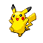

# PokePomo

A Pokemon-themed Pomodoro timer for the desktop. Focus in timed sections,
earn XP with your equipped Pokemon, watch it level up and evolve, and
occasionally find a Mystery Egg while you work.

Built with Electron, vanilla JavaScript and the FireRed/LeafGreen (GBA)
64x64 sprites for all 151 Kanto Pokemon. Everything runs offline: the
Pokedex data and sprites are bundled.



## Features

- **Pomodoro timer** - configurable focus length, short break, long break and
  sections per cycle, with auto-start options.
- **XP and levels** - your equipped Pokemon gains XP per focus section. The
  XP curve is the canonical Pokemon "medium fast" cubic curve (level 16 at
  4096 XP, level 100 at 1,000,000 XP).
- **Evolution** - Pokemon evolve at their real level thresholds (Bulbasaur at
  16, Ivysaur at 32, ...). Trade and stone evolutions are unlocked at a level
  gate instead of an item, so a single-player journey never gets stuck.
- **Starters** - begin with Bulbasaur, Charmander or Squirtle.
- **Mystery Eggs** - each focus section has a configurable chance to drop an
  egg. Eggs hatch after a few completed sections into a random base-form Gen 1
  Pokemon. Rare lucky hatches get a purple aura.
- **Team and Pokedex** - equip any Pokemon from your team and track your
  Kanto Pokedex progress (151 species).
- **Native desktop feel** - tray icon, menu bar badge with the remaining time,
  desktop notifications and window title countdown.

## Getting started

Requires Node.js 18+ (developed on Node 26).

```bash
npm install
npm start
```

## Building an installer

```bash
npm run dist          # current platform
npm run dist:mac      # .dmg + .zip
npm run dist:win      # NSIS installer
npm run dist:linux    # AppImage
```

Build output goes to `dist/`.

## How the game works

| System | Detail |
|---|---|
| XP per focus | `minutes x 18`, scaled by the species `base_experience`, plus a small per-section streak bonus |
| XP per break | `1 x minutes` |
| Cycle bonus | 50% of the XP earned during the finished cycle |
| Level curve | `total XP to reach level L = L^3` (medium fast) |
| Level-up evolution | automatic at the real species level |
| Item/trade evolution | automatic at a level gate (23-34 depending on species) |
| Egg chance | default 14% per focus section, adjustable in Settings |
| Egg hatch | after 6-12 completed focus sections |

## Project layout

```
electron/        main process, preload bridge
src/
  index.html     single-page UI
  css/style.css  pixel-art retro styling
  js/
    pokedex-data.js  GENERATED - Gen 1 data (do not edit by hand)
    pokedex.js       pokedex helpers (names, sprites, stats, types)
    engine.js        XP / level / evolution math
    collection.js    owned Pokemon, eggs, hatching
    timer.js         pomodoro state machine
    store.js         save/load persistence
    audio.js         chiptune sound effects (Web Audio)
    app.js           UI controller
data/pokedex.json    human-readable copy of the Gen 1 data
assets/sprites/      152 PNGs - FireRed/LeafGreen 64x64 sprites (151 + egg)
assets/fonts/        Press Start 2P font
tools/fetch_data.py  regenerates pokedex data + sprites (needs network)
```

To refresh the Pokedex data and sprites from PokeAPI:

```bash
python3 tools/fetch_data.py
```

This rewrites `data/pokedex.json`, `src/js/pokedex-data.js` and
`assets/sprites/`. The app itself never needs the network.

## Save data

The save file lives in the Electron `userData` directory:

- macOS: `~/Library/Application Support/PokePomo/savegame.json`
- Windows: `%APPDATA%/PokePomo/savegame.json`
- Linux: `~/.config/PokePomo/savegame.json`

The exact path is shown in **Settings -> Data**. Use **Reset all data** there to
start over.

## Credits

- Pokemon data and sprites from [PokeAPI](https://pokeapi.co/) and the
  [PokeAPI sprites](https://github.com/PokeAPI/sprites) repository.
- Font: [Press Start 2P](https://fonts.google.com/specimen/Press+Start+2P) by
  CodeMan38, licensed under the SIL Open Font License.

Pokemon and Pokemon character names are trademarks of Nintendo, Game Freak and
Creatures Inc. This is a non-commercial fan project with no affiliation.

## License

MIT - see [LICENSE](LICENSE).
